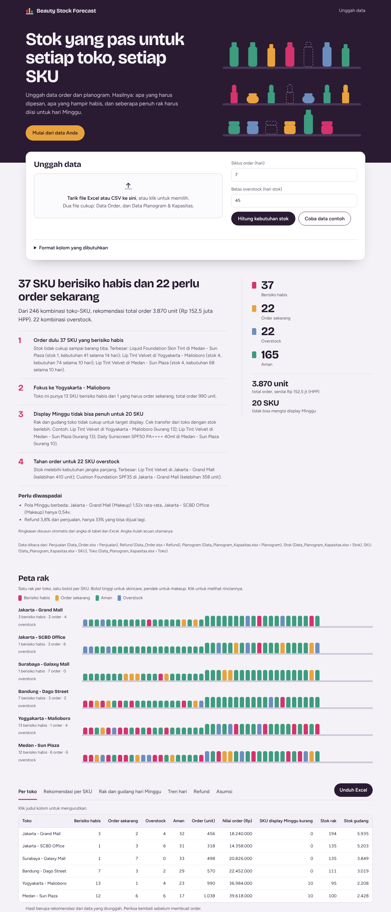

# Beauty Stock Forecast

Upload sales, refund and stock data (Excel or CSV) from a beauty retail chain (skincare & makeup) and get a **stock plan per store per SKU**: what to order, what is about to run out, what is overstocked, how each store behaves by weekday, and whether Sunday's bigger shelf display can be filled from the store's own backroom.

A short written summary turns the numbers into prioritised actions. It is generated from rules by default; set an optional API key for a richer text.



## What it does

| Output | Details |
|--------|---------|
| **Stock status per store × SKU** | `RISIKO HABIS` (will run out before the order arrives), `ORDER SEKARANG`, `AMAN`, `OVERSTOCK` |
| **Order quantity** | Order-up-to level minus stock on hand, rounded up to pack size |
| **Weekday trends** | Day-of-week index per store and category (heatmap), peak day per SKU |
| **Shelf vs backroom** | For the next Sunday: display target vs stock, units to move backroom → shelf, units short, restock runs needed |
| **Refund analysis** | By reason, store and SKU; only resellable returns go back into stock |
| **Summary** | Headline, prioritised actions and watch-outs, written from the computed numbers |
| **Excel export** | Workbook with live formulas: edit shelf/backroom counts and status and order quantities recalculate |

## How the numbers are computed

1. Missing days are filled with 0, and campaign spike days (e.g. 11.11) are detected automatically and excluded from the baseline.
2. **Day-of-week index** per store × SKU, shrunk toward the store × category index when volume is low.
3. **Base demand** = exponentially weighted average of `units / index` over recent days, with a damped trend.
4. **Forecast** over `lead time + review period` on the real calendar (a window with two Sundays gets two Sunday peaks), net of resellable refunds.
5. **Safety stock** = `z × residual std × √(lead time + review)`, with `z` by ABC class (95% / 90% / 80%).
6. Reorder point, order-up-to level, order quantity rounded to pack size.

The optional summary writer only sees aggregated results, never raw rows, and is told to use only those numbers.

## Input files

Upload **two Excel files** (or any mix of Excel and CSV). The kind of every sheet is detected from its **column names**, so file and sheet names do not matter, and sheets such as `Petunjuk` (guide) are ignored.

| File | Sheet | Required | Columns |
|------|-------|----------|---------|
| `Data_Order.xlsx` | Penjualan | yes | `date, store_id, sku, units_sold` |
| | Refund | no | `date, store_id, sku, units_refunded` (optional: `reason`, `units_resellable`) |
| `Data_Planogram_Kapasitas.xlsx` | Planogram | no | `store_id, sku, shelf_target_weekday, shelf_target_sunday` (shelf capacity, weekday vs Sunday) |
| | Stok | yes | `store_id, sku, shelf_stock, backroom_stock` |
| | SKU | yes | `sku, name, category, price, unit_cost, lead_time_days, pack_size` (optional: `subcategory`, `hero_sunday`) |
| | Toko | no | `store_id, store_name` |

Without refunds the app ignores them, without a planogram it estimates display targets from sales. The example workbooks are in [`sample_data/`](sample_data) (synthetic, regenerate with `python scripts/generate_sample_data.py`), and the **Coba data contoh** button uses them. `.csv` also works, one file per table; `.xls` (old format) is not supported.

## Run

### Python

```bash
git clone https://github.com/izraaliya/beauty-stock-forecast.git
cd beauty-stock-forecast
python -m venv .venv
source .venv/bin/activate          # Git Bash on Windows: source .venv/Scripts/activate
pip install -r requirements-dev.txt

export INSIGHT_API_KEY=your-key-here    # optional; PowerShell: $env:INSIGHT_API_KEY="your-key-here"
uvicorn app.main:app --reload
```

Open http://localhost:8000.

### Docker

```bash
cp .env.example .env      # optional: add INSIGHT_API_KEY
docker compose up --build
```

## Configuration

| Variable | Default | Description |
|----------|---------|-------------|
| `INSIGHT_API_KEY` | none | Optional. Enables the richer written summary |
| `INSIGHT_MODEL` | built-in default | Model used for the summary |

## API

Docs at `/docs`.

| Method | Path | Description |
|--------|------|-------------|
| `POST` | `/api/analyze` | Multipart: `files` (Excel and/or CSV), `review_days`, `overstock_days`, `smart_summary` |
| `POST` | `/api/analyze/sample` | Same, using the bundled sample data |
| `GET` | `/api/report/{job_id}.xlsx` | Excel export of an analysis (kept 1 hour) |
| `GET` | `/api/schema` | Expected tables and columns |
| `GET` | `/sample/{name}` | Download an example workbook |

## Tests

```bash
pytest
```

21 tests cover the analysis (invariants, planted weekday patterns recovered, sparse data, validation errors) and the API (Excel and CSV upload, bad files). The summary writer is not called in tests.

## Limitations

- Sales on days a SKU was out of stock are not recorded, so lost demand is not counted. Real data needs a correction for this.
- Reports and results live in memory and are dropped after an hour or a restart.
- Up to 5,000 store × SKU combinations and 25 MB per file per analysis. Very large workbooks load slowly; CSV is faster.
- The written summary can be wrong; the numbers in the tables and the Excel are the source of truth.

## Project structure

```
app/
  analysis.py   # validation + forecasting + stock logic
  insights.py   # written summary with rule-based fallback
  report.py     # Excel builder
  main.py       # FastAPI routes
  static/       # single-page UI
sample_data/    # two example workbooks (Data_Order, Data_Planogram_Kapasitas)
scripts/        # generator for the sample data
tests/
```
